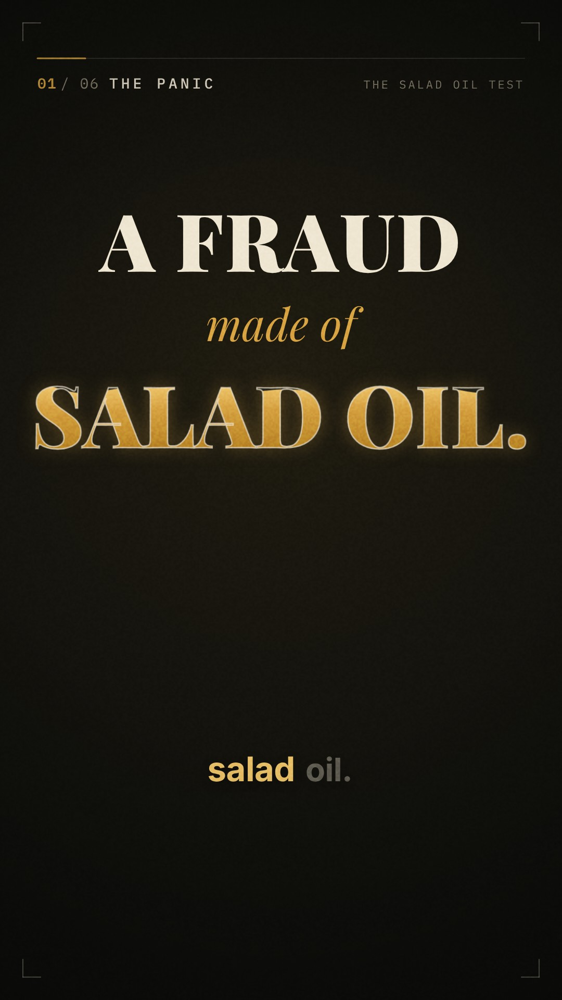

# The Salad Oil Test

**A 60-second documentary short about one real investment decision.** It covers why the decision was made, how its uncertainty was weighed, and what it teaches.



▶ **Watch:** [`output/the-salad-oil-test.mp4`](output/the-salad-oil-test.mp4). Vertical 1080×1920, 30 fps, 60 s, captions burned in, −14 LUFS.

---

## The story in one paragraph

In November 1963, American Express stock nearly halved. A New Jersey commodity trader had borrowed against tanks of "soybean oil" that were mostly water, and an Amex subsidiary had certified the inventory. Warren Buffett asked whether the damage was to the **balance sheet** (large, but finite) or to the **franchise** (customers' trust in the card and travelers cheques). He tested that question in the field. He watched diners pay at Ross's Steak House in Omaha and checked with banks. Trust was intact, so he built the position to about 40% of his partnership. The shares roughly doubled from their lows within about three years.

The film's point is the method, not the return:

> **A falling price is a fact. A falling value is only a hypothesis. Go test it.**

It also warns against outcome bias with the process × outcome matrix (after Russo & Schoemaker).

## Beat sheet

| # | Chapter | What the viewer learns |
|---|---|---|
| 01 | The Panic | What happened, and how the market priced it |
| 02 | The Question | How to reframe a crisis: one-time hit, or lasting damage? |
| 03 | The Test | Scuttlebutt research: get evidence on the one variable that matters |
| 04 | The Bet | Bounded downside vs. compounding upside, and why that allows bigger position sizing |
| 05 | The Lesson | Judge decisions by process, not outcome |
| 06 | The Rule | The line to remember |

The full creative brief, script, shot list, sound design notes and the **fact-check table with sources** are in [`docs/PLAN.md`](docs/PLAN.md).

## How it's made

Everything is generated from code: no stock footage, no stock music.

| Layer | Tool |
|---|---|
| Narration | [Kokoro-82M](https://github.com/thewh1teagle/kokoro-onnx), an open-weights neural TTS model (`src/tts.py`). Lines are timed from the measured audio, and word timings come from pause detection. |
| Picture | A deterministic HTML canvas scene engine (`web/index.html`) with 12 scenes, karaoke captions, film grain, vignette and camera drift |
| Render | Headless Chromium via Playwright, frame by frame, encoded with ffmpeg as x264 CRF 17 (`src/render.mjs`) |
| Score & SFX | Synthesised in NumPy/SciPy (`src/audio.py`): felt-piano arpeggios, pads, convolution reverb, about 40 timed sound cues, and music that ducks under the voice |
| Master | Compression, a limiter, and two-pass EBU R128 loudness normalisation to −14 LUFS / −2 dBTP |
| Type | Playfair Display, IBM Plex Mono, Inter (all SIL OFL) |

### Rebuild

```bash
pip install kokoro-onnx soundfile scipy numpy
./build.sh              # full build -> output/the-salad-oil-test.mp4
./build.sh --stills     # review stills only -> build/stills/
```

To preview, serve the repo root (`npx serve .`) and open `/web/index.html` to play it live with sound. Open `/web/index.html?t=17.5` to inspect a single frame.

## Disclaimer

Educational content, not investment advice. Share prices are approximate and the chart is illustrative. Where sources disagree, the figures are deliberately conservative; see the fact-check in `docs/PLAN.md`.
