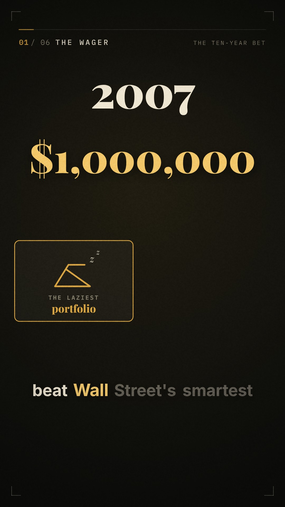

# Decisions Under Uncertainty: documentary shorts

Two vertical (9:16) educational films about real investment decisions. Each covers what was decided, why, how the uncertainty was weighed, and what it teaches. Both come from one code-driven pipeline, with no stock footage and no stock music.

| | Film | Length | Watch |
|---|---|---|---|
|  | **The Ten-Year Bet**: Buffett's 2008–2017 wager that an S&P 500 index fund would beat five funds of hedge funds | 120 s | [`output/the-ten-year-bet.mp4`](output/the-ten-year-bet.mp4) |
|  | **The Salad Oil Test**: Buffett's 1964 American Express purchase after the salad oil scandal | 60 s | [`output/the-salad-oil-test.mp4`](output/the-salad-oil-test.mp4) |

Both are 1080×1920, 30 fps, with captions burned in, mastered to −14 LUFS.

## The Ten-Year Bet in brief

In 2007, Buffett bet $1M that "the laziest portfolio on Earth" would beat "Wall Street's smartest money" over ten years, net of fees.

- **Why:** arithmetic, not a forecast. Before costs, active managers as a group earn the market's return, because together they are the market (Sharpe, 1991). After layered fees, they must trail it.
- **How he weighed uncertainty:** skill was uncertain, but costs were certain. He bet only on the certain part, then held through a losing first year: −37% in 2008, while the hedge funds lost less.
- **A second lesson, from the stake:** in 2012 the "safe" Treasury bonds would pay under 1% a year, so both sides moved the stake into Berkshire stock. Risk is the chance of missing your goal, not price wiggles.
- **Result:** the index fund gained 126% (≈ 8.5%/yr). The five funds of funds gained between 3% and 88%. About 60% of their gains went to fees, by Buffett's estimate.
- **Rigor:** the film gives the fair counterpoint (one decade is one sample), then shows the cost identity holds in bull, bear and flat markets.

Each film's creative brief, script, shot list, sound design and **fact-check table with sources** is in its `PLAN.md`:
[`films/ten-year-bet/PLAN.md`](films/ten-year-bet/PLAN.md) · [`films/salad-oil/PLAN.md`](films/salad-oil/PLAN.md).
The post copy, with sources, for each platform upload is in [`output/`](output/).

## How it's made

```
films/<film>/script.json  ──► src/tts.py ──► build/<film>/vo/*.wav + timeline.json (measured line and word timings)
films/<film>/sound.py     ──► src/audio.py ──► score + SFX + ducked voice ──► -14 LUFS master
films/<film>/scenes.js    ──► web/engine.js (deterministic canvas engine) ──► src/render.mjs (Playwright → ffmpeg)
                                                                          └──► output/<slug>.mp4
```

| Layer | Tool |
|---|---|
| Narration | [Kokoro-82M](https://github.com/thewh1teagle/kokoro-onnx), an open-weights neural TTS model. Lines are laid out from the measured audio, and word timings come from pause detection, which drives the karaoke captions and every animation cue. |
| Picture | `web/engine.js`: a deterministic canvas engine with scene crossfades, chapter chrome, captions, film grain, vignette and camera drift. Each film adds its own scenes in `films/<film>/scenes.js`. |
| Render | Headless Chromium renders each frame; ffmpeg encodes x264 (CRF 17 master, CRF 21 delivery) |
| Score & SFX | NumPy/SciPy synthesis: felt-piano arpeggios, pads, convolution reverb, a per-film harmony map and timed cues, with the music ducking under the voice |
| Master | Compression, a limiter, and two-pass EBU R128 loudness normalisation to −14 LUFS / −2 dBTP |
| Type | Playfair Display, IBM Plex Mono, Inter (all SIL OFL) |

### Rebuild

```bash
pip install kokoro-onnx soundfile scipy numpy
./build.sh ten-year-bet            # -> output/the-ten-year-bet.mp4
./build.sh salad-oil               # -> output/the-salad-oil-test.mp4
./build.sh ten-year-bet --stills   # review stills only -> build/ten-year-bet/stills/
```

To preview, serve the repo root (`npx serve .`) and open `/web/index.html?film=ten-year-bet` to play it with sound. Add `&t=52` to inspect a single frame.

## Disclaimer

Educational content, not investment advice. Charts are labelled where they are illustrative. Where secondary sources disagree, the films use the primary figures from Buffett's letters; see each fact-check table.
